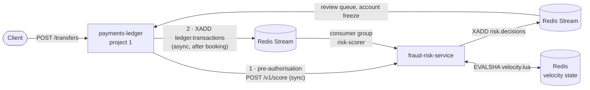
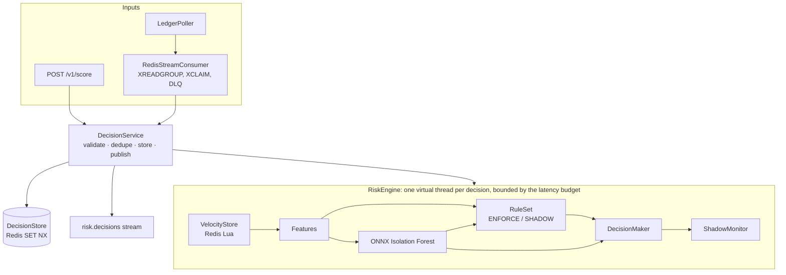

# Fraud Risk Scoring Service

[](https://github.com/SanicaVinayakMyana/fraud-risk-service/actions/workflows/ci.yml)


A real-time fraud and risk scoring microservice for payments. It consumes transaction events from the
[payments ledger](https://github.com/SanicaVinayakMyana/payments-ledger) and answers **ALLOW**, **REVIEW** or
**BLOCK** within a latency budget, with a **reason code for every decision**.

Each decision combines three things:

- **Velocity rules in Redis**: sliding windows such as "more than 5 transactions in 60 s" or "new device plus a
  high amount", updated and read atomically in one Lua script.
- **An ML anomaly score**: an Isolation Forest trained in scikit-learn, exported to ONNX and run in-process in Java
  with ONNX Runtime (about 25 µs per inference).
- **Shadow mode**: a new rule logs the decision it *would* have caused without enforcing it, until someone promotes
  it at runtime.

**Stack:** Java 21 (records, sealed interfaces, virtual threads) · Javalin · Redis 7 (Lua, Streams, consumer
groups) · ONNX Runtime · scikit-learn · Micrometer + Prometheus · Spock + Testcontainers · Docker · GitHub Actions

| What is verified | How |
|---|---|
| p50 **64 µs** / p99 **0.3 ms** per decision in-process; p50 **141 µs** / p99 **0.48 ms** including the Redis round trip | [`LatencySpec`](src/test/groovy/com/sanica/risk/engine/LatencySpec.groovy), real ONNX model and all rules |
| The Redis Lua windows match the reference implementation exactly | [`RedisVelocityStoreSpec`](src/test/groovy/com/sanica/risk/features/RedisVelocityStoreSpec.groovy): 600 randomised events, out of order, with duplicates |
| No lost updates when replicas race on one account | 200 concurrent writers on 2 connections see the counts 1..200 exactly once |
| Model: ROC-AUC **0.999**, recall **99%** at 1% false positives (simulated data) | [`model-metadata.json`](src/main/resources/model/model-metadata.json); the CI `model` job retrains and fails on regression |
| ONNX export reproduces scikit-learn | max abs. error 2.3e-7 on 50k held-out rows, checked before the file is written |
| Slow or failed Redis never breaks the latency budget | `RiskEngineSpec`: a 500 ms store under a 30 ms budget returns the fallback in time |
| 131 tests, 95% line coverage | JaCoCo; the build fails below 85% |

## Contents

- [Quick start](#quick-start)
- [How the two services talk](#how-the-two-services-talk)
- [Architecture](#architecture)
- [Scoring: rules + model → one decision](#scoring-rules--model--one-decision)
- [Velocity windows in Redis](#velocity-windows-in-redis)
- [The model](#the-model)
- [Shadow mode](#shadow-mode)
- [Latency budget and degradation](#latency-budget-and-degradation)
- [API](#api)
- [Configuration](#configuration)
- [Testing](#testing)
- [Project layout](#project-layout)

## Quick start

**Requirement:** JDK 21 (for example [Eclipse Temurin](https://adoptium.net/)). Nothing else: no Redis, no Python.

```bash
git clone https://github.com/SanicaVinayakMyana/fraud-risk-service.git
cd fraud-risk-service
./gradlew runLocal
```

Open **http://localhost:8081**. `runLocal` keeps state in memory and turns on demo traffic: 200 simulated
customers make everyday payments, and every 25 seconds one of them is attacked. The **Simulate an attack** buttons
trigger card testing, account takeover, mule fan-out or an amount spike on demand. On Windows, use
`.\gradlew.bat runLocal`.

**Both services together** (ledger, PostgreSQL, Redis and the risk service, all in containers):

```bash
docker compose up --build
```

The ledger is at http://localhost:8080 and the risk service at http://localhost:8081. Transfers made in the
ledger's dashboard show up in the risk service's decisions within a second.

## How the two services talk



There are three integration paths, all ending in the same `DecisionService`:

1. **Synchronous pre-authorisation.** The ledger calls `POST /v1/score` before booking a transfer and refuses or
   holds it on BLOCK or REVIEW. This path has the latency budget.
2. **Asynchronous events.** The ledger (or any producer) `XADD`s a JSON event to the `ledger.transactions` stream.
   Replicas share the work through a consumer group, and decisions are published to `risk.decisions`. Use this for
   post-booking checks: flag the account, open a review case.
3. **Ledger polling bridge.** With `LEDGER_URL` set, the service polls the ledger's existing `GET /transactions`
   endpoint and feeds new transactions into path 2. The two services then work together with **no change to the
   ledger**, which is what `docker compose` uses.

Scoring is **idempotent per transaction id**. A redelivered stream entry, a retried HTTP call or a transaction seen
by both the poller and the stream gets the original decision back, and that decision is published once.

## Architecture



| Package | Responsibility |
|---|---|
| `features` | `VelocityStore` (Redis Lua and an in-memory twin), `Features` (the model's inputs and the rules' fields) |
| `ml` | `OnnxAnomalyModel`: loads the ONNX file, checks its feature list, runs inference, calibrates the score |
| `rules` | JSON rule definitions, parsed into a sealed `Condition` tree and validated at load time |
| `engine` | `RiskEngine` (latency budget, degradation), `DecisionMaker` (scoring policy), `ShadowMonitor`, decision stores |
| `stream` | Redis Streams consumer and producer, and the ledger polling bridge |
| `sim` | Traffic simulator with labelled attacks: training data, demo traffic and test fixtures |

## Scoring: rules + model → one decision

Every decision has a 0-100 risk score in which **every point is explained by a reason**:

- Each matching **enforced rule** adds its `points` and contributes a reason with its evidence, for example
  `CARD_TESTING: Burst of small card payments (channel=CARD, txCount60s=18, amountUsd=2.22)`.
- The **model** adds `40 × anomaly score` points and an `ML_ANOMALY` reason, but only when the anomaly score is at
  least 0.5. Below that it adds nothing, so a decision never carries points that no reason accounts for.
- **Score ≥ 50 → REVIEW, ≥ 80 → BLOCK.** A rule can also carry an `action` that forces a minimum decision
  whatever the score, such as the hard amount limit or card testing.
- Reasons are ordered by importance: forcing rules first, then by points. An ALLOW with nothing to report carries
  `LOW_RISK`. A degraded decision carries the cause, such as `LATENCY_BUDGET_EXCEEDED`.

Every decision also records the **model version and rules version** it was made with, for audit and replay.

The shipped rules ([`rules.json`](src/main/resources/rules.json)):

| Rule | Condition | Points | Mode |
|---|---|---|---|
| `VELOCITY_60S` | more than 5 transactions in 60 s | 45 | enforce |
| `CARD_TESTING` | card, ≥ 8 in 60 s, amount < 10 USD | 60, forces BLOCK | enforce |
| `VELOCITY_1H` | more than 30 transactions in an hour | 35 | enforce |
| `NEW_DEVICE_HIGH_AMOUNT` | first payment from this device and ≥ 1,000 USD | 55 | enforce |
| `NEW_COUNTRY_HIGH_AMOUNT` | first payment from this country and ≥ 500 USD | 40 | enforce |
| `AMOUNT_SPIKE` | z-score > 6 against the account's history and ≥ 250 USD | 30 | enforce |
| `MULE_FAN_OUT` | transfers to ≥ 8 different payees within an hour | 45 | enforce |
| `HARD_AMOUNT_LIMIT` | single payment > 25,000 USD | 100, forces BLOCK | enforce |
| `FIRST_TX_HIGH_AMOUNT` | account's first payment ≥ 2,000 USD | 50 | **shadow** |
| `RAPID_REPEAT` | under 3 s since the previous payment | 25 | **shadow** |
| `NIGHT_NEW_DEVICE` | new device between 01:00 and 05:00 UTC | 30 | **shadow** |

Rules are data. Adding one is a JSON change; a typo in a field name or operator fails at startup with a clear
message rather than becoming a rule that silently never matches:

```json
{
  "id": "NEW_DEVICE_HIGH_AMOUNT",
  "description": "First payment from this device and amount of at least 1,000 USD",
  "points": 55,
  "mode": "ENFORCE",
  "when": { "all": [
    { "field": "newDevice", "op": "==", "value": true },
    { "field": "amountUsd", "op": ">=", "value": 1000 }
  ]}
}
```

Conditions support `all`, `any`, `not`, numeric comparisons (`> >= < <= == !=`) and `in` for text fields
(`channel`, `country`, `currency`). Numeric fields: `amountUsd`, `txCount60s`, `txCount1h`, `amountSum1hUsd`,
`distinctCounterparties1h`, `newDevice`, `newCountry`, `priorTxCount`, `amountZScore`, `secondsSinceLastTx`,
`hourOfDay` and `mlScore`.

## Velocity windows in Redis

[`velocity.lua`](src/main/resources/velocity.lua) runs once per transaction and, atomically:

1. trims the account's sorted sets to the last hour;
2. checks whether the transaction id was already recorded (a redelivery), and if not
3. records it: transaction ids and amounts in sorted sets scored by timestamp, counterparties with their latest
   timestamp, devices and countries in sets, and running mean and variance (Welford) in a hash;
4. returns every window: counts in 60 s and 1 h, the USD sum in 1 h, distinct counterparties in 1 h, new device,
   new country, prior count, mean, standard deviation and seconds since the previous transaction.

Design decisions:

- **Record and read in one atomic step.** A separate "read counts, then add" would let two replicas both see
  "4 in the last minute" and both allow a sixth payment. Lua scripts run without interleaving, which
  `RedisVelocityStoreSpec` checks with 200 concurrent writers on two connections.
- **One round trip.** All six keys of an account are read and written by one `EVALSHA`. If Redis restarted and lost
  its script cache, the store reloads the script and retries.
- **Windows use the event's timestamp, not the wall clock**, so replays, backfills and the offline training set
  produce exactly the features live traffic would have produced.
- **Cluster-ready keys.** Every key of an account carries the hash tag `{accountId}`, so they share one cluster
  slot, as a multi-key script requires.
- **Bounded memory.** Window keys expire after an hour of inactivity and per-account history after 90 days.
- **An in-memory twin** (`InMemoryVelocityStore`) implements exactly the same semantics for local runs, tests and
  training-data generation. The spec replays 600 randomised events (out of order, with duplicates, missing devices,
  four currencies) through both and requires identical results.

## The model

```bash
./gradlew exportTrainingData                                  # Java: simulated traffic → ml/data/features.csv
uv run --with-requirements ml/requirements.txt ml/train_isolation_forest.py   # Python: train, export, verify
```

- **No training/serving skew.** The training set is produced by replaying simulated traffic through the
  **production** feature code (`InMemoryVelocityStore` + `Features`). The model's metadata lists its input
  features, and the service refuses to start if they differ from what it computes.
- **Unsupervised.** The Isolation Forest is fitted on unlabelled traffic with 1% contamination, as it would be on
  real data where fraud labels arrive weeks later. The simulator's labels are used only for evaluation on a
  held-out 20%.
- **A compact ONNX export.** The stock skl2onnx converter emits several graph nodes per tree, which took about
  2 ms per inference for 200 trees. An Isolation Forest only needs each tree's path length for the leaf a sample
  reaches, so [`train_isolation_forest.py`](ml/train_isolation_forest.py) writes the whole forest as **one
  `TreeEnsembleRegressor`** whose leaves hold those path lengths, followed by the closed-form score. Inference
  dropped to about **25 µs** in Java, and the script verifies the export against scikit-learn before writing it.
- **Calibration.** The raw `decision_function` (below 0 means outlier) goes through a logistic curve centred on
  the contamination threshold, giving a 0-1 anomaly score in which 0.5 is the model's own outlier boundary.

Held-out results on simulated traffic (50,392 transactions, 0.67% fraud):

| Metric | Value |
|---|---|
| ROC-AUC | 0.9994 |
| Average precision | 0.94 |
| Recall at 1% false-positive rate | 99.1% |
| Flagged as outliers: account takeover / amount spike / card testing / mule fan-out | 100% / 100% / 98.8% / 93.8% |
| Flagged as outliers: normal traffic | 0.36% |

These numbers come from **simulated** traffic, where attacks are cleaner than in real life. They show that the
pipeline works end to end, not how the model would perform on a real portfolio. That is also why the model is one
input among several rather than the decision: rules carry the known patterns with explicit reasons, and the model
catches combinations nobody wrote a rule for.

## Shadow mode

A rule in `SHADOW` mode is evaluated on every transaction but never counts towards the live decision. For each
transaction the service records:

- the live decision, and next to it a `shadow` outcome: the decision and score **if all shadow rules were enforced**;
- for each shadow rule on its own, whether enforcing *that rule alone* would have changed the decision (for
  example `ALLOW->REVIEW`), as counters, Prometheus metrics and a log line with the evidence:

```
INFO shadow - rule=FIRST_TX_HIGH_AMOUNT tx=8c1e… account=acct-42 live=ALLOW wouldBe=REVIEW evidence="Account's very first payment is at least 2,000 USD (priorTxCount=0, amountUsd=3000)"
```

`GET /v1/shadow/report` summarises it per rule: hits, hit rate and decision changes. This is the information a
risk team needs before switching a rule on: "it fires on 2% of traffic and would have sent 0.4% to review".
Promotion is a runtime call, with no deploy, and every decision records the rules version it was made with:

```bash
curl -X PUT localhost:8081/v1/rules/FIRST_TX_HIGH_AMOUNT/mode \
     -H 'X-Admin-Token: …' -H 'Content-Type: application/json' -d '{"mode": "ENFORCE"}'
```

A rule set is immutable. A mode change swaps in a new version atomically (`2026-10-25.1` → `2026-10-25.1-r1`), so
no decision is ever made with half of one version and half of another.

## Latency budget and degradation

Every decision runs on its own virtual thread and is bounded by `LATENCY_BUDGET_MS` (default 50 ms):

| Failure | Behaviour | Reason code |
|---|---|---|
| Redis slow beyond the budget | the configured fallback (default REVIEW) is returned on time | `LATENCY_BUDGET_EXCEEDED` |
| Redis down or erroring | fallback decision | `FEATURES_UNAVAILABLE` |
| Model inference fails | rules still decide; the decision is flagged as degraded | `MODEL_UNAVAILABLE` |

Degraded decisions carry `"degraded": true` and are counted in `risk_decisions_total{degraded="true"}`, so an
alert can fire long before anyone notices more manual reviews. The fallback is configurable: REVIEW suits
payments (hold, do not lose the sale), while ALLOW suits low-risk flows that value availability.

Measured in [`LatencySpec`](src/test/groovy/com/sanica/risk/engine/LatencySpec.groovy) on a laptop, with all rules
and the real model:

| Path | p50 | p99 |
|---|---|---|
| In-process (velocity in memory) | 64 µs | 0.30 ms |
| With Redis (local) | 141 µs | 0.48 ms |
| ONNX inference alone | 24 µs | 0.11 ms |

`risk_scoring_latency_seconds` is exported as a Prometheus histogram with a bucket at the budget, so the share of
decisions within the SLO is a single query.

## API

| Method | Path | Purpose |
|---|---|---|
| `POST` | `/v1/score` | Score a transaction synchronously (idempotent per `transactionId`) |
| `GET` | `/v1/decisions/{transactionId}` | The stored decision for a transaction |
| `GET` | `/v1/decisions?limit=50` | Recent decisions, newest first |
| `GET` | `/v1/rules` | Active rule set, with each rule's mode and the fields it reads |
| `PUT` | `/v1/rules/{id}/mode` | `ENFORCE`, `SHADOW` or `DISABLED` (needs `X-Admin-Token` when `ADMIN_TOKEN` is set) |
| `GET` | `/v1/shadow/report` | Per-rule shadow hits and decision changes |
| `GET` | `/v1/model` | Model version, features and evaluation metrics |
| `GET` | `/health` | Liveness, with the model and rules versions |
| `GET` | `/metrics` | Prometheus metrics |
| `POST` | `/v1/demo/attacks/{scenario}` | Demo mode only: `card-testing`, `account-takeover`, `mule-fan-out`, `amount-spike` |

```bash
curl -s localhost:8081/v1/score -H 'Content-Type: application/json' -d '{
  "transactionId": "tx-1001", "accountId": "acct-42", "counterpartyId": "acct-77",
  "amount": 1500.00, "currency": "EUR", "channel": "TRANSFER",
  "deviceId": "dev-new", "country": "DE", "timestamp": "2026-10-25T14:03:11Z"
}'
```

For an account that has history, usually spends around 1,000 USD, and is now paying from a device it has never
used before:

```json
{
  "transactionId": "tx-1001",
  "accountId": "acct-42",
  "decision": "REVIEW",
  "score": 55,
  "reasons": [
    { "code": "NEW_DEVICE_HIGH_AMOUNT", "points": 55,
      "detail": "First payment from this device and amount of at least 1,000 USD (newDevice=1, amountUsd=1620.00)" }
  ],
  "mlScore": 0.31,
  "shadow": null,
  "degraded": false,
  "modelVersion": "iforest-20261025-5c446fb5",
  "rulesVersion": "2026-10-25.1",
  "latencyMicros": 212,
  "decidedAt": "2026-10-25T14:03:11.204Z"
}
```

Events on the `ledger.transactions` stream use the same JSON in a single `payload` field:
`XADD ledger.transactions * payload '{"transactionId": …}'`. `deviceId` and `country` are optional (server-to-server
transfers have neither) and unknown fields are ignored, so the ledger can add fields without a coordinated deploy.
Malformed events go to `ledger.transactions.dlq` instead of blocking the consumer group.

## Configuration

| Variable | Default | Meaning |
|---|---|---|
| `PORT` | `8081` | HTTP port |
| `REDIS_URL` | unset | Redis for velocity state, decisions and streams; unset means in-memory, single instance |
| `INPUT_STREAM` / `DECISION_STREAM` | `ledger.transactions` / `risk.decisions` | Stream names |
| `CONSUMER_GROUP` / `CONSUMER_NAME` | `risk-scorer` / `$HOSTNAME` | Consumer group membership |
| `LATENCY_BUDGET_MS` | `50` | Maximum time to a decision |
| `FALLBACK_DECISION` | `REVIEW` | Decision when the budget is exceeded or Redis fails |
| `REVIEW_THRESHOLD` / `BLOCK_THRESHOLD` | `50` / `80` | Score thresholds |
| `ML_WEIGHT` / `ML_REASON_THRESHOLD` | `40` / `0.5` | Model points at score 1.0; minimum score to contribute |
| `RULES_PATH` | bundled `rules.json` | Rule file to load instead of the bundled one |
| `LEDGER_URL` / `LEDGER_POLL_MS` | unset / `1000` | Poll the payments ledger for new transactions |
| `ADMIN_TOKEN` | unset | Required in `X-Admin-Token` for rule changes and demo attacks |
| `DEMO_MODE` | `false` | Generate demo traffic |

## Testing

```bash
./gradlew check    # 131 Spock tests + the 85% coverage gate
```

Redis-backed tests use Redis 7 in Docker through Testcontainers when Docker is available (CI). Otherwise they fall
back to an embedded `redis-server`, so the whole suite also runs on a laptop with nothing installed. For the same
reason, reclaiming abandoned stream entries uses `XPENDING` + `XCLAIM`, which works on any Redis from 5.0, rather
than `XAUTOCLAIM`, which needs 6.2.

| Spec | Covers |
|---|---|
| `InMemoryVelocityStoreSpec`, `RedisVelocityStoreSpec` | Window edges, dedupe, Welford statistics, Lua/Java parity, concurrent replicas, script-cache loss |
| `RuleParserSpec`, `RuleRepositorySpec` | Every operator and combinator, evidence strings, load-time validation errors, versioned mode changes |
| `OnnxAnomalyModelSpec` | Feature-order guard, separation of attacks from normal traffic on a fresh simulation, calibration |
| `DecisionMakerSpec`, `RiskEngineSpec` | Thresholds, forced actions, reason ordering, shadow outcomes, latency budget, Redis and model failures |
| `RedisStreamConsumerSpec` | End-to-end scoring from the stream, redelivery, dead-lettering, reclaiming a crashed replica's entries |
| `LedgerPollerSpec`, `ApplicationSpec` | The ledger's real response shape, both integration paths, demo mode |
| `RiskApiSpec` | The HTTP contract, validation errors, admin token, Prometheus output |
| `LatencySpec` | p50/p99 with the real model, with and without Redis |

The CI `model` job rebuilds the training set from the Java feature code, retrains, and fails if ROC-AUC drops below
0.95, recall at 1% FPR drops below 80%, or the ONNX export stops matching scikit-learn.

## Project layout

```
src/main/java/com/sanica/risk/
  Application.java, Config.java    wiring and environment configuration
  api/                             Javalin routes, JSON mapper
  domain/                          TransactionEvent, RiskDecision, Reason, Decision, Money
  engine/                          RiskEngine, DecisionMaker, ShadowMonitor, DecisionService, stores
  features/                        VelocityStore (Redis + in-memory), Features
  ml/                              OnnxAnomalyModel, ModelMetadata
  rules/                           Condition, Rule, RuleSet, RuleParser, RuleRepository
  sim/                             TrafficSimulator, TrainingDataExporter, DemoTraffic
  stream/                          RedisStreamConsumer, RedisStreams, LedgerPoller
src/main/resources/
  rules.json  velocity.lua  model/isolation_forest.onnx  model/model-metadata.json  public/ (dashboard)
ml/
  train_isolation_forest.py  requirements.txt
```

## License

MIT
